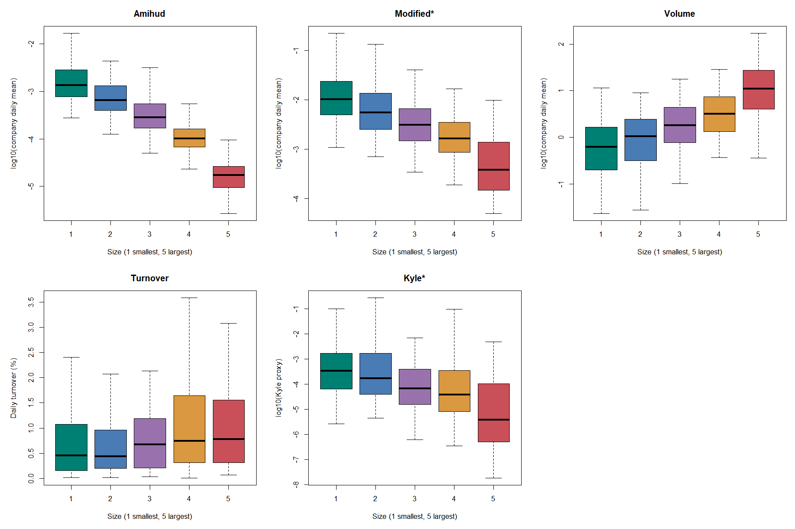
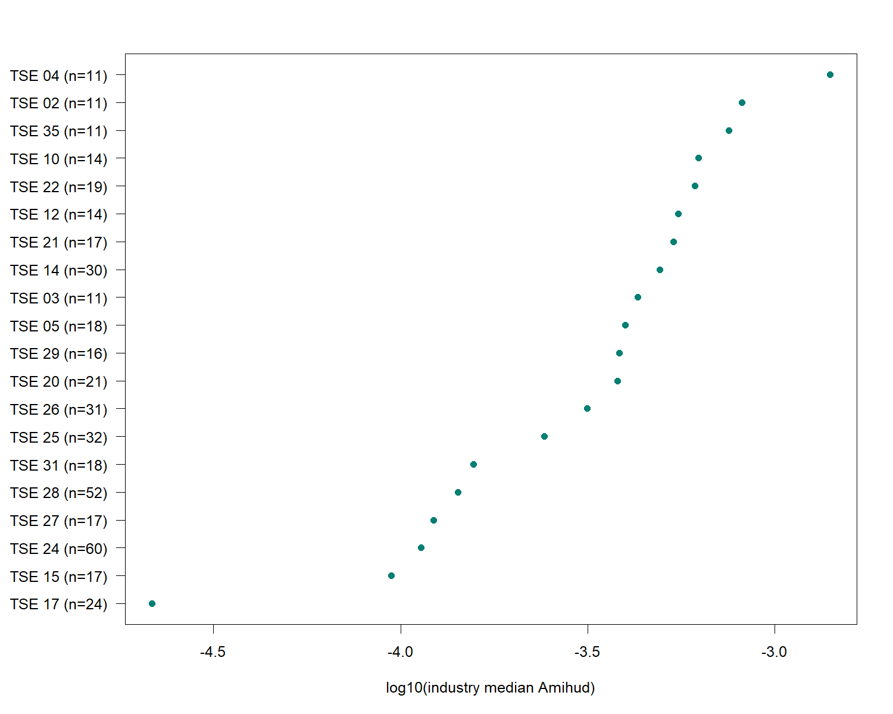
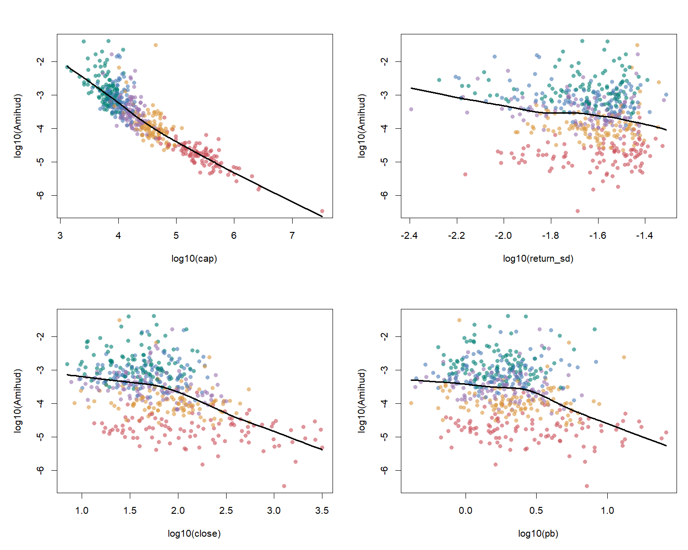
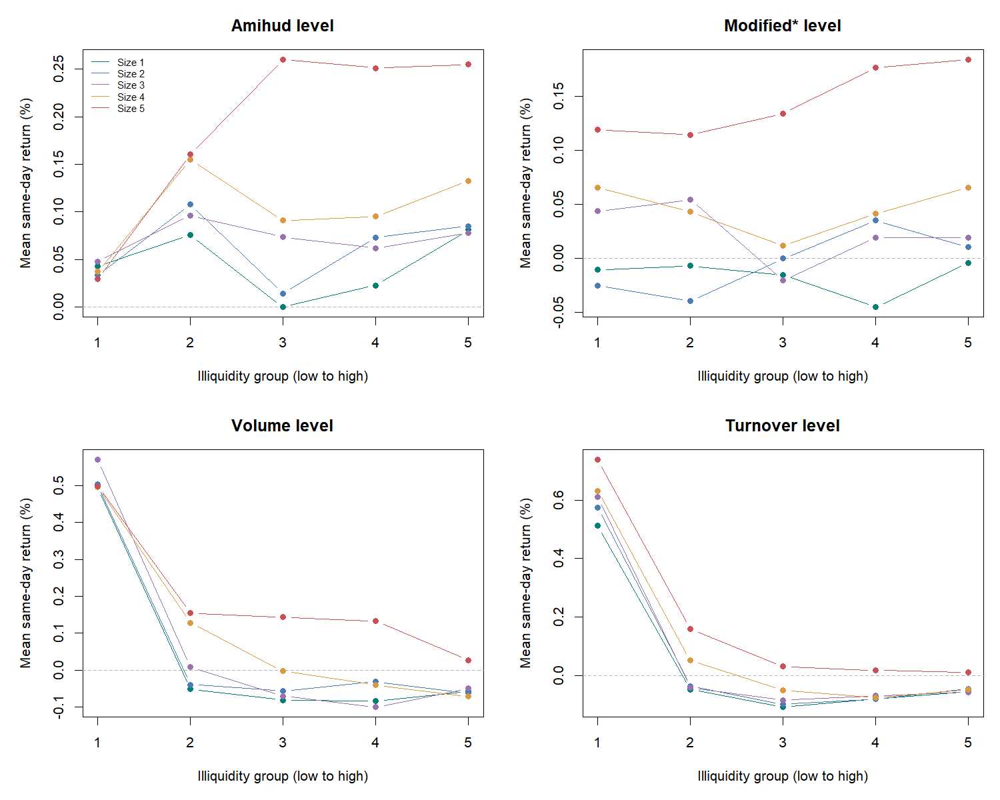
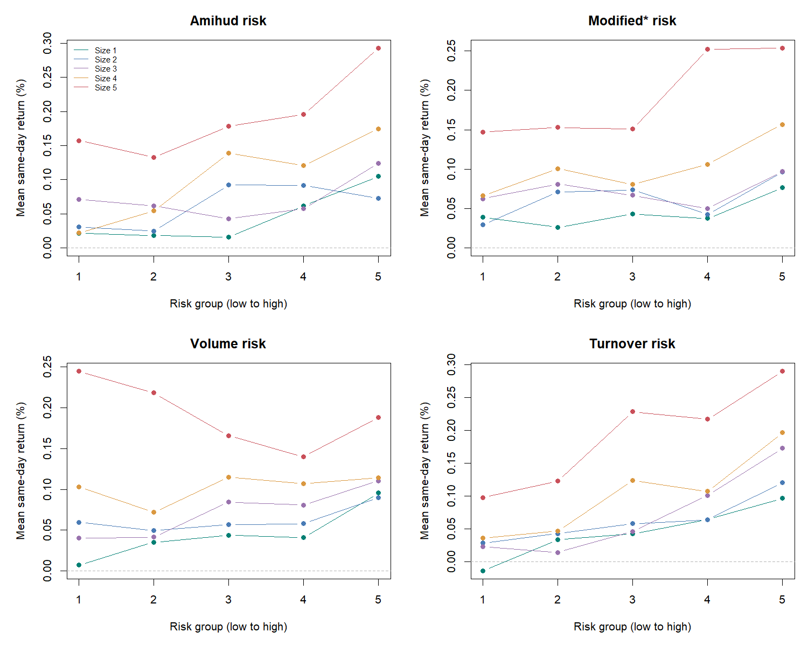
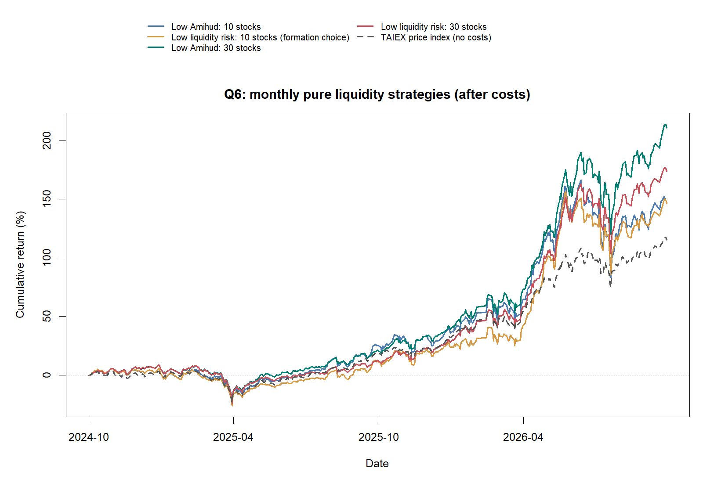

# HW2：股票流動性實證分析

## 樣本與分組

使用 TEJ 2023-10-11 至 2026-10-08 的每日資料。原始共有 1085 家，剔除缺少完整交易日有效收盤價的 53 家，剩下 1032 家。
按 2026-10-08 市值由大到小取前 750 家，依排名分成五個 150 家區段，每段取市值較大的 100 家，最後保留 **500 家、728 個交易日、364,000 筆公司日資料**。這樣保留不同規模公司，並排除各區段較小者；不是直接取前 500 家。
最終 500 家依期末市值由小到大固定分為五組，每組 100 家，組 1 最小、組 5 最大。若升冪市值名次為 $`R_i`$，則 $`G_i=\lceil R_i/100\rceil`$，三年間組別不變。產業使用同一份 TEJ 檔的期末 TSE 產業分類。
這是期末選樣的回顧性分析；新上市、退出或資料不完整者會因缺少完整歷史而被剔除。此條件存在存續及事後選樣偏誤，不能當成當時已知的投資名單。完整收盤價也不代表每個指標都有完整值。

## Q1：五種流動性指標

令 $`r_{it}`$ 為小數日報酬，$`D_{it}`$ 為成交金額（百萬元），$`V_{it}`$ 為成交量（百萬股），$`P_{it}`$ 為收盤價。$`t-1`$ 一律指前一個交易日，不是前一個日曆日；$`T`$ 指樣本最後交易日。TEJ 報酬率、週轉率除以 100；成交值（千元）、成交量（千股）除以 1,000。

| 指標 | 計算方式 | 數值越高代表 |
|---|---|---|
| Amihud | $`A_{it}=\lvert r_{it}\rvert/D_{it}`$ | 較不流動 |
| Modified* | $`M_{it}=S_{it}/\bar D_{it}^{(30)}`$ | 較不流動 |
| 成交量 | $`V_{it}`$，百萬股 | 交易較活躍 |
| 週轉率 | TEJ 週轉率％除以 100 | 換手較頻繁 |
| Kyle* | $`\lambda_i^*=s_i(r)^2/s_i(V)^2`$ | 本代理下價格衝擊較大 |

**Amihud：**每天計算；成交金額為零或無效時留缺值。報酬為零且成交金額為正時，Amihud 為零。公司指標為三年有效每日值的平均。

**Modified：**依講義的 Roll 價差代理計算：

```math
S_{it}=\frac12\sqrt{-\widehat{Cov}_{s=t-27,\ldots,t}(\Delta P_{i,s},\Delta P_{i,s-1})},\qquad \Delta P_{i,s}=P_{i,s}-P_{i,s-1}.
```
```math
\bar D_{it}^{(30)}=\frac1{30}\sum_{s=t-29}^{t}D_{is},\qquad M_{it}=S_{it}/\bar D_{it}^{(30)}.
```
每天取最近 30 個交易日收盤價，得到 29 個價格變動、28 組相鄰配對，以樣本共變異數估計，再除以同 30 日平均成交金額。前 29 日、共變異數非負或視窗資料無效時留缺值，不補零。分母平均包含零成交日，但須大於零。
30 日是本組設定，得到的是每日更新的估計價差，不是直接觀察的每日買賣價差。係數 0.5 沿用講義，與 Roll 原文係數 2 不同；價格調整口徑也尚待確認，因此保留 Modified* 標記。

**Kyle：**依本組討論，以三年每日小數報酬的樣本標準差代理 asset risk，以三年每日成交量的樣本標準差代理 noise trading risk，沿用講義第 18 頁的平方比。每家公司只有一個固定值；這不是每日迴歸的 Kyle lambda，也未識別真正的雜訊交易風險，故標為 Kyle*。

### Q1(1)：相關矩陣

每天在公司之間，對兩項指標同時有效的觀察計算 Spearman 排名相關，同值採平均名次，再將有效日期的相關係數等權平均。不是先算公司三年平均後跑 Pearson 相關。Kyle 雖固定，仍有公司間差異。

```math
\bar\rho_{jk}=\frac{1}{T_{jk}}\sum_{t\in\mathcal T_{jk}}\rho^S_t(L_j,L_k).
```

| 指標 | Amihud | Modified* | Volume | Turnover | Kyle* |
| --- | --- | --- | --- | --- | --- |
| Amihud | 1.000 | 0.579 | -0.613 | -0.438 | 0.403 |
| Modified* | 0.579 | 1.000 | -0.868 | -0.475 | 0.812 |
| Volume | -0.613 | -0.868 | 1.000 | 0.692 | -0.767 |
| Turnover | -0.438 | -0.475 | 0.692 | 1.000 | -0.335 |
| Kyle* | 0.403 | 0.812 | -0.767 | -0.335 | 1.000 |

Amihud 與 Modified 正相關；兩者與成交量、週轉率負相關，方向符合高不流動性通常伴隨較少交易的描述。成交量與週轉率正相關，但交易股數與換手比例並不相同。Kyle 與成交量負相關，部分來自其公式本來就以成交量波動作分母，不能當成獨立驗證。

### Q1(2)：五個市值組

先算各公司三年有效每日平均，再取組內公司平均值的中位數；Kyle 直接取組內中位數。**下表是中位數，不是各組平均，也不是 log 值。** 週轉率以 % 顯示。

| 市值組 | Amihud | Modified* | 成交量（百萬股） | 週轉率（%） | Kyle* |
| --- | --- | --- | --- | --- | --- |
| 1 | 0.00136072 | 0.0101513 | 0.620719 | 0.451394 | 0.000331032 |
| 2 | 0.000648152 | 0.005559 | 1.05403 | 0.43821 | 0.000166348 |
| 3 | 0.000282764 | 0.0031017 | 1.79486 | 0.670683 | 6.67634e-05 |
| 4 | 0.000100943 | 0.00161887 | 3.15032 | 0.744988 | 3.70578e-05 |
| 5 | 1.7185e-05 | 0.000376309 | 11.024 | 0.777399 | 3.79951e-06 |



箱型圖的 Amihud、Modified、成交量與 Kyle 使用 log10，方便比較差距很大的數值；週轉率使用百分比。箱型圖不顯示離群點，但未從統計計算刪除；非正值無法取 log，僅在該圖不顯示。
市值較大的組別，Amihud、Modified 與 Kyle 中位數較低，成交量較高。週轉率整體較高，但組 2 低於組 1，並非完全單調。

### Q1(3)：公司特徵



每點為一個至少有 10 家樣本公司的產業，橫軸為公司日均 Amihud 的產業內中位數（log10），n 為公司數。TSE 17 的中位數最低，TSE 04 最高。產業代碼直接取 TEJ，不憑未核對的名稱對照解讀；差異也可能反映公司規模。



每點一家公司，顏色代表市值組，黑線為整體平滑趨勢。市值與 Amihud 的負向關係最明顯；股價與股價淨值比亦大致負向。報酬波動的圖較分散，不能簡化成波動越大就越不流動。圖中 cap 是三年每日市值平均，與選樣使用的期末市值不同。這些是描述關係，不代表因果。

## Q2：哪個指標最能代表流動性？

**本組選 Amihud 作為主要指標。** 它將價格變動與成交金額一起考慮，較單看成交量或週轉率接近價格衝擊概念，而且現有每日資料即可直接計算，容易說明與重現。
但 Amihud 使用絕對報酬，也會混入消息與股價波動，並非真正的交易成本。Modified 需要間接估計價差且有較多缺值；Kyle 使用本組指定的風險代理。因此以 Amihud 為主，其餘指標互相對照，而不宣稱某項完全衡量所有流動性面向。

## Q3：流動性風險與報酬

每家公司每項每日指標的風險，定義為三年有效每日值的樣本標準差：

```math
Risk_i^{L,\mathrm{full}}=\sqrt{\frac{\sum_{s\in\mathcal T_i^L}(L_{is}-\bar L_i)^2}{n_i^L-1}}.
```

每家公司只有一個風險值，不逐日滾動。上標 full 表示使用整段樣本的有效日期集合 $`\mathcal T_i^L`$，不是只用到 $`t-1`$ 的歷史風險；在早期日期也會包含當時尚未發生的資料，因此只作回顧性描述。這是流動性指標的波動程度，不是市場流動性 beta。Kyle 已是公司固定代理，沒有可估的每日時間序列風險，故 Q3–Q5 僅用另外四項。Modified 有效天數因公司而異。

下表是市值組內公司風險的中位數，未年化。成交量為百萬股，週轉率風險為百分點；各欄單位不同，不直接比較大小。

| 市值組 | Amihud 風險 | Modified* 風險 | 成交量風險（百萬股） | 週轉率風險（百分點） |
| --- | --- | --- | --- | --- |
| 1 | 0.00221106 | 0.00798132 | 1.18467 | 0.795125 |
| 2 | 0.00100769 | 0.00445215 | 1.89241 | 0.801554 |
| 3 | 0.000441452 | 0.00213885 | 2.93735 | 1.00555 |
| 4 | 0.000177396 | 0.00107303 | 3.67402 | 0.983756 |
| 5 | 2.65223e-05 | 0.000218205 | 11.0446 | 0.701389 |

**水準圖：**每天在每個固定市值組內，依當日指標再分五組；成交量與週轉率反向排序，使第 1 組較流動、第 5 組較不流動。各組先算每日等權報酬，再對日期等權平均。



成交量與週轉率最活躍組的同日平均報酬明顯較高；Amihud 與 Modified 的關係因市值組而異，沒有一致單調方向。

**風險圖：**在每個市值組內，依公司三年風險分固定五組，第 1 組風險最低、第 5 組最高，再以相同方式比較每日平均報酬。



Amihud 與 Modified 的高風險組大致有較高平均報酬，但並非各組逐級上升。週轉率風險與報酬大致正向；成交量風險則有明顯規模差異，大型股不呈一致正向。這些圖是全期描述，不是可直接交易的預測訊號。

## Q4：多元迴歸

使用公司每日資料合併估計 OLS，不先把每日報酬平均。每項指標分開估計水準及風險模型，共八個模型：

**當日水準模型：**

```math
r_{it}^{(\%)}=a_L+b_LL_{it}+c_L\log(MCap_{it})+d_LR_{mt}+\sum_{k\ne k_0}\gamma_{L,k} I(Industry_{i,T}=k)+\varepsilon_{it}^{L}.
```

**全期公司風險模型：**

```math
r_{it}^{(\%)}=a_R+b_RRisk_i^{L,\mathrm{full}}+c_R\log(MCap_{it})+d_RR_{mt}+\sum_{k\ne k_0}\gamma_{R,k} I(Industry_{i,T}=k)+\varepsilon_{it}^{R}.
```

兩式分別估計，係數不要求相同。應變數是每日報酬率（%），指標使用原始尺度，成交量、週轉率不反向。控制當日市值自然對數、期末產業分類虛擬變數及同日市場報酬；省略一個產業作基準。$`Industry_{i,T}`$ 表示取期末分類並固定套用，不表示每天重新分類。沒有公司固定效果；否則公司固定的風險值無法另外識別。標準誤按公司與交易日雙向群聚。
**下標與資料時點：** $`r_{it}`$ 是從前一交易日至當日的 TEJ 報酬，但仍標為 $`t`$ 期報酬；$`L_{it}`$ 是當日指標，Modified 雖用到歷史價格，視窗仍包含 $`t`$ 日資料；$`MCap_{it}`$ 是當日市值，不是前日市值。本題估計同日關係，故不把這些變數一律改成 $`t-1`$。真正使用前日市值的是下式的市場權重。

市場代理仍是 500 家樣本公司以前日市值加權的當日報酬（%），不是 Q6 的官方 TAIEX：

```math
w_{i,t-1}^{m}=\frac{MCap_{i,t-1}}{\sum_{j\in\mathcal S_t}MCap_{j,t-1}},\qquad R_{mt}=100\sum_{i\in\mathcal S_t}w_{i,t-1}^{m}r_{it}.
```

$`\mathcal S_t`$ 是當日報酬及前日正市值皆有效的樣本公司集合。權重標為 $`t-1`$，乘上的報酬標為 $`t`$，所以算出的市場報酬仍是 $`R_{mt}`$，不是 $`R_{m,t-1}`$。這與迴歸控制變數使用的當日市值不同。

首日沒有前日市值，故市場報酬缺值而排除；其他缺值按各模型需要另行排除。風險模型不要求當天的原指標有效，只要求該公司的全期風險值與控制變數有效。

| 指標 | 模型 | 係數 | p值 | 觀察數 |
| --- | --- | --- | --- | --- |
| Amihud | 當日流動性 | 0.0248782 | 0.976 | 363156 |
| Amihud | 公司流動性風險 | 1.94917 | 0.006 | 363500 |
| Modified* | 當日流動性 | 0.142483 | 0.057 | 203706 |
| Modified* | 公司流動性風險 | 0.684765 | <0.001 | 363500 |
| Volume | 當日流動性 | 0.00702813 | <0.001 | 363500 |
| Volume | 公司流動性風險 | -0.000256834 | 0.533 | 363500 |
| Turnover | 當日流動性 | 13.7116 | <0.001 | 363500 |
| Turnover | 公司流動性風險 | 2.45067 | <0.001 | 363500 |

係數代表指標增加一個原始單位的日報酬差異（百分點）。週轉率以小數輸入，增加 1 個百分點的效果為表列係數乘 0.01；不同指標係數不能直接比較大小。

**當日水準：**Amihud未達 5% 顯著水準；Modified*未達 5% 顯著水準；成交量為顯著正向；週轉率為顯著正向。
**公司風險：**Amihud為顯著正向；Modified*為顯著正向；成交量未達 5% 顯著水準；週轉率為顯著正向。

與 Q3 對照，成交量與週轉率的活躍程度正向關係，以及 Amihud、Modified、週轉率風險的正向關係，大致與迴歸一致。成交量風險在不同市值組的方向不一，控制後未顯著。Amihud 水準的分組圖非單調，迴歸也未顯著；Modified 水準 p=0.057，未達 5% 門檻。
這是同日關係，不是預測或因果，且 Amihud 分子本來包含當日絕對報酬；全期風險也使用整段資料，不能直接作事前交易訊號。

## Q5：上漲日與下跌日是否不同？

沿用 Q4 的樣本市場代理，$`Down_t=I(R_{mt}<0)`$ 表示當日下跌，否則為 0。雖然市場權重使用 $`t-1`$ 市值，判斷漲跌仍用當日報酬，故下標保留 $`t`$，不是 $`Down_{t-1}`$。上下市況一起放進同一個模型，不分開估計：

```math
r_{it}^{(\%)}=a+bRisk_i^{L,\mathrm{full}}+eDown_t+f(Risk_i^{L,\mathrm{full}}\times Down_t)+c\log(MCap_{it})+dR_{mt}+\sum_{k\ne k_0}\gamma_k I(Industry_{i,T}=k)+\varepsilon_{it}.
```

上漲組（包含零報酬日）的風險斜率為 $`b`$，下跌日為 $`b+f`$，差異為 $`f`$；檢驗 $`H_0:f=0`$。表中 p 值檢驗兩種市況斜率是否不同，不是分別檢驗各斜率。控制變數與雙向群聚標準誤同 Q4。

| 指標 | 上漲日係數 | 下跌日係數 | 差異 | p值 | 觀察數 |
| --- | --- | --- | --- | --- | --- |
| Amihud | -0.194037 | 4.80238 | 4.99642 | 0.065 | 363500 |
| Modified* | -0.0873791 | 1.71311 | 1.80049 | 0.041 | 363500 |
| Volume | 0.00356465 | -0.00535491 | -0.00891955 | <0.001 | 363500 |
| Turnover | 10.4307 | -8.23653 | -18.6672 | <0.001 | 363500 |

Amihud的上下跌日斜率差異未達 5% 顯著水準；Modified*的上下跌日斜率差異達 5% 顯著水準；成交量的上下跌日斜率差異達 5% 顯著水準；週轉率的上下跌日斜率差異達 5% 顯著水準。

Modified 的下跌日風險斜率較高；成交量與週轉率風險的下跌日斜率較低，且由正轉負。Amihud 雖也有斜率方向改變，但差異 p=0.065，不能在 5% 水準認定不同。Modified 的解讀仍受間接價差與價格調整限制。

## Q6：純流動性月度策略

本題改以四個純流動性月度策略作為正式比較。

### 策略規則

每月第一個交易日收盤換股；訊號截至前一個交易日。過去 60 個交易日的 Amihud 平均值代表流動性，標準差代表流動性風險，至少需 40 個有效值。
令 $`t`$ 為換股交易日，$`\mathcal W_{i,t-1}`$ 為 $`t-60`$ 至 $`t-1`$ 之間 Amihud 有效的交易日集合，$`n_{i,t-1}=|\mathcal W_{i,t-1}|\ge40`$。選股訊號的下標必須是 $`t-1`$：

```math
\bar A_{i,t-1}^{(60)}=\frac{1}{n_{i,t-1}}\sum_{s\in\mathcal W_{i,t-1}}A_{is},\qquad SignalRisk_{i,t-1}^{A,(60)}=\sqrt{\frac{\sum_{s\in\mathcal W_{i,t-1}}(A_{is}-\bar A_{i,t-1}^{(60)})^2}{n_{i,t-1}-1}}.
```

這裡的 60 日風險只用到前一交易日，與 Q3–Q5 的全期 $`Risk_i^{L,\mathrm{full}}`$ 不同。
在目前 500 家母樣本中，按 Amihud 平均值或標準差由低至高排序，直接選前 10／30 家。每月換股時等權，月中權重隨股價變動；不放空、不槓桿。測試期首日另依前日訊號建立初始持股。
每次換股先計算當日舊持股報酬，再於收盤調整。成本為 0.3% × 買賣權重變動絕對值合計，初始買入與期末賣出也扣成本；這是簡化的換手成本模型。TAIEX 為不扣成本、未計股利再投資的官方價格指數。策略採 TEJ 報酬，配息口徑待確認，因此不宣稱完全同口徑的總報酬比較。
若 $`w_{i,t-1}^{p}`$ 是前一交易日收盤換股完成後的持股權重，換股前的當日組合毛報酬為：

```math
r_{p,t}^{\mathrm{gross}}=\sum_i w_{i,t-1}^{p}r_{it}.
```

$`t`$ 日收盤新買入的股票，從 $`t+1`$ 日起才貢獻報酬。首日原先持有現金，僅扣初始買入成本，不計新持股首日報酬；每日淨報酬另外反映當日換手成本，期末再扣賣出成本。
指數來源：[臺灣證券交易所](https://www.twse.com.tw/zh/indices/taiex/mi-5min-hist.html)。

形成期：2024-04-19 至 2024-10-09。依形成期資訊比率選定 **S02**。測試期：2024-10-11 至 2026-10-08；全部策略採相同日期。

### 為什麼這樣建構？

1. **直接用流動性選股。** Amihud 為每日絕對報酬除以成交金額；平均值低，代表每單位成交金額伴隨的價格變動較小，是較容易交易的代理。這是檢驗高流動性組合能否獲利，不是認定高流動性必然有高報酬；不流動性若有報酬補償，方向也可能相反。
2. **另測流動性是否穩定。** 過去 60 日 Amihud 的標準差低，代表這個指標變化較小。因此另建低流動性風險組合；標準差低不保證平均 Amihud 低，也不等於股價風險低，兩種排序分開比較。
3. **60 日摘要、每月換股。** 約三個月的歷史可降低單日異常成交的影響，又能隨近期流動性更新；每月而非每日換股可限制換手成本。這是簡單可解釋的設定，不是已證明最適的期間，也不同於 Modified Amihud 中 Roll 的 30 日窗口。
4. **比較 10 家與 30 家，採等權。** 10 家較集中，30 家較分散，用來比較集中程度；等權避免少數大型股權重主導。不再強制五個市值組各占 20%，所以結果也可能包含市值與產業配置差異，不能全歸因於流動性。
5. **只用交易前已知訊號。** 月底排序，下一個交易日收盤換股；買入日不計新持股當日報酬，之後按每日報酬累積並扣成本，再與 TAIEX 比較。目的在實測，不是先假定策略必定勝過大盤。

### 實測結果

TAIEX 同期累積報酬：**115.33%**。

| 策略 | 流動性篩選 | 持股數 | 扣成本累積報酬 | 超過大盤（百分點） | 年化波動 | 最大回撤 |
|---|---|---:|---:|---:|---:|---:|
| S05 | 低 Amihud | 30 | 210.50% | 95.17 | 30.53% | -29.75% |
| S06 | 低 Amihud 風險 | 30 | 173.47% | 58.14 | 29.46% | -30.24% |
| S01 | 低 Amihud | 10 | 146.92% | 31.60 | 33.87% | -31.29% |
| S02（形成期選定） | 低 Amihud 風險 | 10 | 146.34% | 31.02 | 32.93% | -30.28% |
| TAIEX | 大盤價格指數 | — | 115.33% | 0.00 | 25.65% | -26.71% |

事後測試期最佳為 **S05**；形成期選定的是 **S02**，必須分開解讀。超過大盤欄為兩個累積報酬相減，不是年化 alpha。



圖中四條實線為已扣成本的策略，虛線為 TAIEX。縱軸是累積報酬率，例如 210.50% 表示資金約變成 3.105 倍，不是 2.105 倍；買入日已扣初始成本，策略起點因此略低於零。所有曲線使用相同進出日期，未從績效終點回推繪圖。

形成期選定的 S02 在測試期超過大盤，但平均日超額報酬檢定 p=0.431，未達 5% 顯著水準。事後最佳的低 Amihud、30 家組合不能當成事前選定；其波動與最大回撤也高於大盤。

### 解讀限制

目前只比較 4 個純流動性規則，但先前曾比較其他規則的事實並未消失。仍存在挑選贏家偏誤，未做多重比較修正；新的未使用期間才可再驗證。
母樣本仍按期末市值及完整三年資料選定，有存續與事後選樣偏誤；未模擬成交限制、價格衝擊及停牌，配息口徑也未確認。少量持股有集中風險，不能以累積報酬高就認定較穩健。
comparison.csv 包含波動、最大回撤、資訊比率及平均日超額報酬雙尾 Newey–West 5 階 p 值；holdings.csv 可核對每次持股與訊號截止日。
